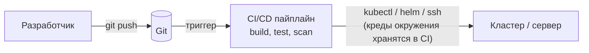
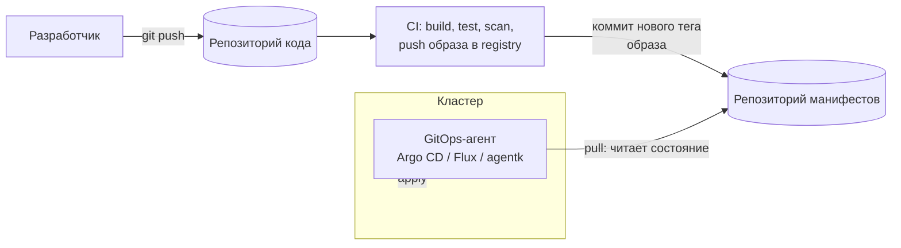

# CI/CD: типы, push- и pull-модели, ограничения инструментов и безопасность

> СРО «КиберРиск и КиберРазведка». Теоретическое исследование, без практической части.
> Актуальность фактов по инструментам: ноябрь 2026. Версии и лимиты тарифов меняются, перед внедрением сверяйтесь с документацией.

## Содержание

1. [Основные понятия](#1-основные-понятия)
2. [Типы CI/CD](#2-типы-cicd)
3. [Push-модель](#3-push-модель)
4. [Pull-модель (GitOps)](#4-pull-модель-gitops)
5. [Сравнение push и pull](#5-сравнение-push-и-pull)
6. [Инструменты и их ограничения](#6-инструменты-и-их-ограничения)
7. [Безопасность](#7-безопасность)
8. [Где использовать push, где pull](#8-где-использовать-push-где-pull)
9. [Выводы](#9-выводы)
10. [Источники](#10-источники)

---

## 1. Основные понятия

| Термин | Что означает |
|---|---|
| **CI** (Continuous Integration) | Частое слияние изменений в общую ветку; на каждый коммит автоматически запускаются сборка и тесты. |
| **Continuous Delivery** | Каждая успешная сборка готова к выкатке; на прод выкатывают вручную (кнопка, approve). |
| **Continuous Deployment** | То же, но выкатка на прод полностью автоматическая, без ручного шага. |
| **Pipeline** | Описанная в коде последовательность стадий: build → test → scan → package → deploy. |
| **Runner / agent / executor** | Процесс, который реально выполняет задачи пайплайна. |
| **GitOps** | Подход, где единственный источник истины об инфраструктуре и приложении это Git, а состояние окружения автоматически приводится к описанному в Git. |
| **Drift (дрейф)** | Расхождение между состоянием в Git и реальным состоянием окружения (кто-то поправил руками). |
| **Reconciliation** | Постоянное сравнение желаемого и фактического состояния и устранение расхождений. |

CI и CD отвечают за разное: CI проверяет, что код собирается и проходит тесты, CD доставляет результат в окружение. Push и pull относятся именно к **доставке (CD)**, а не к сборке.

---

## 2. Типы CI/CD

Единой классификации нет, поэтому ниже сгруппировано по тому, что важно для сравнения.

### 2.1. По стратегии доставки (как обновляется окружение)

| Тип | Суть | Типичные инструменты |
|---|---|---|
| **Push-based** | Внешняя система (пайплайн) сама заходит в окружение и применяет изменения. | Jenkins, GitLab CI, GitHub Actions, CircleCI, Buildkite |
| **Pull-based (GitOps)** | Агент внутри окружения сам следит за репозиторием и подтягивает изменения. | Argo CD, Flux, GitLab agent for Kubernetes |
| **Гибрид** | CI собирает образ и коммитит новый тег в репозиторий манифестов, дальше работает pull-агент. Самый распространённый вариант на практике. | GitLab CI + Argo CD / Flux |

### 2.2. По месту размещения

| Тип | Плюсы | Минусы |
|---|---|---|
| **SaaS / облачный** (GitLab.com, GitHub Actions, CircleCI) | Нет обслуживания, быстрый старт. | Зависимость от провайдера, данные и секреты уходят в чужую инфраструктуру, лимиты тарифа. |
| **Self-hosted** (GitLab self-managed, Jenkins, TeamCity) | Полный контроль, данные внутри периметра. | Обновления, отказоустойчивость и безопасность на вашей стороне. |
| **Гибрид** (SaaS-оркестратор + свои runner'ы) | Чувствительные задачи крутятся у вас, интерфейс у провайдера. | Нужно защищать собственные runner'ы. |

### 2.3. По способу описания пайплайна

- **Конфигурация как код** (`.gitlab-ci.yml`, `Jenkinsfile`, workflow YAML): версионируется, проходит review.
- **Настройка через UI** (старые Jenkins-джобы): плохо воспроизводится и аудируется, считается антипаттерном.

### 2.4. По модели исполнения

- **Централизованный сервер с воркерами** (Jenkins controller + agents, GitLab + runners).
- **Cloud-native, контейнерный** (Tekton, Argo Workflows): каждый шаг это под в Kubernetes.
- **Serverless-раннеры** (эфемерные ВМ или контейнеры на каждый запуск): лучше изоляция, дороже холодный старт.

---

## 3. Push-модель

### Как работает

CI/CD-система после успешной сборки **сама подключается к целевому окружению** (по SSH, через `kubectl`, Helm, Ansible, Terraform, API облака) и применяет изменения. Для этого ей нужны учётные данные окружения.

### Плюсы

- Простота: не нужно ставить ничего в целевое окружение, настроить можно за часы.
- Универсальность: подходит для ВМ, bare metal, облачных API, Kubernetes, мобильных релизов. Не привязано к Kubernetes.
- Гибкость: в пайплайне можно описать любую последовательность шагов (миграции БД, smoke-тесты, ручные approve, уведомления).
- Один инструмент на весь путь от коммита до прода, привычен командам.
- Результат деплоя виден сразу в самом пайплайне (успех или падение).

### Минусы

- **Креды окружения лежат в CI.** Компрометация пайплайна или раннера даёт доступ к проду. Это главный недостаток.
- Часто требуется, чтобы кластер был доступен снаружи (открытый API-сервер, правила файрвола для IP раннеров) или нужно строить VPN/туннель.
- **Нет контроля дрейфа**: пайплайн не знает, что кто-то поменял ресурс руками, до следующего запуска (и тогда перезапишет).
- Состояние окружения не гарантированно соответствует Git: деплой это разовое событие, а не постоянный процесс.
- Масштабирование на десятки кластеров ведёт к росту числа кредов, джоб и копипасты пайплайнов; новое окружение обычно требует правки пайплайнов.
- Откат это новый запуск пайплайна, а не `git revert` с автоматическим применением.

---

## 4. Pull-модель (GitOps)

### Как работает

Внутри целевого окружения (чаще всего Kubernetes-кластера) работает **агент/оператор**. Он:

1. периодически (или по webhook) читает Git-репозиторий с желаемым состоянием (манифесты, Helm-чарты, Kustomize);
2. сравнивает с фактическим состоянием кластера;
3. при расхождении применяет изменения сам.

Исходящее соединение идёт **из** кластера **наружу**, а не наоборот.

Основные принципы GitOps: декларативное описание, версионирование в Git, автоматическое применение, постоянная сверка (reconciliation).

### Плюсы

- **Безопаснее по архитектуре**: креды кластера остаются внутри кластера, CI не нужен admin-доступ к проду, не нужно открывать API кластера наружу.
- **Self-healing**: ручные правки откатываются, дрейф обнаруживается и устраняется.
- **Аудит и откат через Git**: любое изменение это коммит с автором и review; откат это `git revert`.
- **Масштабируемость**: добавить ещё один кластер значит подключить агента к тому же репозиторию.
- Работа за NAT и файрволом: достаточно исходящего соединения.
- Чёткое разделение: CI отвечает за сборку, GitOps за доставку.

### Минусы

- **Почти только Kubernetes.** Для ВМ, bare metal и произвольных серверов pull-агентов в этом смысле нет или они менее зрелые (GitLab прямо указывает, что в pull-модели цели деплоя ограничены Kubernetes).
- Агента нужно установить, обновлять и мониторить в **каждом** кластере; он потребляет ресурсы и сам становится привилегированным компонентом.
- Выше порог входа: нужна структура репозиториев (код отдельно, манифесты отдельно), понимание Helm/Kustomize, RBAC агента.
- Событийная модель: результат деплоя виден не в пайплайне, а в UI/статусе агента; нужна интеграция уведомлений.
- Сложнее то, что зависит от порядка и разовых действий: миграции БД, hooks, зависимости между приложениями.
- **Секреты нельзя хранить в Git открытым текстом**: нужны Sealed Secrets, SOPS, External Secrets Operator или Vault.
- Дополнительный шаг «CI коммитит тег образа в репозиторий манифестов» усложняет цепочку (или нужен image automation, как в Flux).
- Eventual consistency: между коммитом и применением есть задержка (интервал опроса), если не настроены webhook'и.

---

## 5. Сравнение push и pull

| Критерий | Push | Pull (GitOps) |
|---|---|---|
| Кто инициирует деплой | CI/CD-система | Агент в целевом окружении |
| Где хранятся креды окружения | В CI (секреты, переменные) | Внутри окружения, у агента |
| Сетевой доступ | CI должен достучаться до цели | Цель сама ходит наружу к Git |
| Контроль дрейфа | Нет (только при следующем запуске) | Да, постоянная сверка |
| Источник истины | Состояние после последнего пайплайна | Git |
| Откат | Перезапуск пайплайна со старой версией | `git revert`, агент применяет |
| Цели деплоя | Любые (ВМ, облако, K8s, bare metal) | В основном Kubernetes |
| Порог входа | Низкий | Выше |
| Скорость старта | Часы | Дни |
| Масштабирование на много окружений | Растёт сложность пайплайнов и кредов | Хорошо масштабируется |
| Видимость результата | В пайплайне сразу | В UI агента, асинхронно |
| Гибкость кастомных шагов | Очень высокая | Ограничена (hooks, sync waves) |
| Аудит | Логи пайплайна | История Git + события агента |
| Главный риск | Компрометация CI даёт доступ к проду | Компрометация репозитория манифестов или самого агента |

Важное замечание: «pull безопаснее» верно для **сетевой и учётной модели**, но это не делает его неуязвимым (см. раздел 7). Источники расходятся в оценках: часть авторов называет pull предпочтительным для продакшена, другие (например, DoiT) считают push через CI вполне нормальным вариантом. Единой «правильной» модели нет, есть компромиссы под контекст.

---

## 6. Инструменты и их ограничения

### 6.1. Push-ориентированные

| Инструмент | Сильные стороны | Ограничения и риски |
|---|---|---|
| **GitLab CI/CD** | Всё в одной платформе (репозиторий, CI, registry, security-сканеры); `.gitlab-ci.yml`; runner'ы любых типов. | Часть security-функций (SAST/DAST расширенные, compliance) зависит от тарифа; на SaaS есть лимиты вычислительных минут; runner'ы нужно защищать (особенно shared); сложные пайплайны с `include`/`rules` тяжело отлаживать. |
| **GitHub Actions** | Огромный маркетплейс готовых actions, глубокая интеграция с GitHub. | Сторонние actions это зависимость из чужого кода; теги версий **изменяемы** (атака tj-actions, см. раздел 7); лимиты минут на тарифах; привязка к GitHub. |
| **Jenkins** | Самый гибкий, тысячи плагинов, полностью self-hosted. | Нужно администрировать controller и агентов самим; плагины нередко источник уязвимостей и несовместимостей; controller это точка отказа; нет встроенного контроля дрейфа; legacy-джобы через UI не воспроизводимы. |
| **CircleCI / Buildkite / TeamCity** | Быстрые облачные/гибридные раннеры, хороший кэш. | Привязка к вендору; были публичные инциденты у самих провайдеров CI (CircleCI, январь 2023; TeamCity, март 2024), то есть сам CI-провайдер тоже часть поверхности атаки. |

Общее ограничение push-инструментов: **всё зависит от секретов, которые у них хранятся**, и от изоляции раннеров.

### 6.2. Pull-ориентированные

| Инструмент | Сильные стороны | Ограничения |
|---|---|---|
| **Argo CD** | Зрелый веб-UI с визуализацией ресурсов, RBAC и SSO, мультикластерность, ApplicationSet, hooks (PreSync/Sync/PostSync). | Только Kubernetes; собственный набор компонентов для эксплуатации (repo-server, application-controller, Redis и т.д.); синхронизация может быть ручной (explicit sync) и требовать действия; сам является привилегированным компонентом; нужен отдельный механизм секретов. |
| **Flux** | Лёгкий, модульный (GitOps Toolkit), нативный image automation (может сам обновлять теги в Git); автоматическая сверка по умолчанию. | Нет зрелого встроенного UI (есть сторонние, менее развитые); только Kubernetes; более «консольный» опыт, выше порог для тех, кому нужна наглядность. |
| **GitLab agent for Kubernetes** (agentk + kas) | Агент открывает **исходящий** канал к GitLab (kas), кластер не нужно выставлять наружу; поддерживает и pull (через Flux), и push через CI/CD-туннель. В GitLab Free с версии 14.5; Flux рекомендован как GitOps-решение с версии 15.10. | Привязка к GitLab; нужно ставить агент в каждый кластер; для pull-деплоя GitLab опирается на Flux, то есть это не отдельный движок; kas надо эксплуатировать на self-managed. |
| **Spinnaker / Tekton / Argo Workflows** | Продвинутые стратегии выката (canary, blue/green) / cloud-native пайплайны. | Высокая сложность эксплуатации, нужны отдельные компетенции. |

### 6.3. Что важно помнить при выборе

- GitOps-инструменты решают **доставку**, но не сборку и не тесты: CI всё равно нужен.
- Ни один pull-инструмент не заменяет push для не-Kubernetes целей.
- Любой инструмент это ещё один привилегированный компонент, который нужно патчить и мониторить.

---

## 7. Безопасность

CI/CD-система находится в доверенной позиции: у неё есть доступ к исходникам, секретам, артефактам и продакшену. Поэтому для атакующего это точка входа высокой ценности.

### 7.1. Реальные инциденты

| Инцидент | Что произошло | Урок |
|---|---|---|
| **SolarWinds (2020)** | Атакующие проникли в процесс сборки и внедрили бэкдор SUNBURST в обновления Orion. | Скомпрометированная сборка означает скомпрометированный продукт у всех клиентов. Нужна целостность build-среды. |
| **Codecov (2021)** | Из-за ошибки в создании Docker-образа атакующие изменили Bash Uploader; скрипт утекал переменные окружения CI клиентов. Обнаружено 1 апреля 2021. Пострадали сотни клиентов. | Любой внешний скрипт, который выполняется в CI, видит ваши секреты. |
| **tj-actions/changed-files (март 2025)** | Скомпрометирован популярный GitHub Action (CVE-2025-30066, CVSS 8.6), затронуто более 23 000 репозиториев; атакующие переписали существующие теги версий на вредоносный коммит, секреты печатались в логи сборки. Атака шла через предварительную компрометацию reviewdog («цепочечная» атака). | Теги в Git изменяемы: ссылаться на action нужно по **хэшу коммита**, а не по тегу. |
| **Инциденты у провайдеров CI** (CircleCI 2023, TeamCity 2024 и др.) | Атаки на самих поставщиков CI/CD. | Даже SaaS-CI это часть вашей поверхности атаки; секреты нужно делать короткоживущими. |

### 7.2. OWASP Top 10 CI/CD Security Risks

Проект OWASP (первый релиз v1.0, сентябрь 2022) классифицирует риски конвейеров:

| № | Риск | Суть простыми словами |
|---|---|---|
| CICD-SEC-1 | Insufficient Flow Control Mechanisms | Один человек может протолкнуть код на прод без review/approve. |
| CICD-SEC-2 | Inadequate Identity and Access Management | Лишние права, неотозванные аккаунты, общие учётки. |
| CICD-SEC-3 | Dependency Chain Abuse | Вредоносные или подменённые зависимости (typosquatting, dependency confusion). |
| CICD-SEC-4 | Poisoned Pipeline Execution (PPE) | Атакующий меняет конфиг пайплайна (`.gitlab-ci.yml`) и выполняет свой код в CI. |
| CICD-SEC-5 | Insufficient PBAC (Pipeline-Based Access Controls) | У джобы пайплайна больше прав, чем нужно (общий токен на всё). |
| CICD-SEC-6 | Insufficient Credential Hygiene | Секреты в коде, логах, переменных без маскирования, не ротируются. |
| CICD-SEC-7 | Insecure System Configuration | Небезопасные настройки и непатченные CI-системы. |
| CICD-SEC-8 | Ungoverned Usage of 3rd Party Services | Неконтролируемые интеграции и сторонние приложения с доступом к репозиториям. |
| CICD-SEC-9 | Improper Artifact Integrity Validation | Артефакты не подписываются и не проверяются, их можно подменить. |
| CICD-SEC-10 | Insufficient Logging and Visibility | Нет логов и мониторинга, атаку не заметить и не расследовать. |

### 7.3. Безопасность push-модели

Основные угрозы:

- **Кража секретов из CI**: переменные окружения, токены доступа к кластеру и облаку. Утечка через логи (пример tj-actions: двойное base64-кодирование обходило маскирование секретов).
- **Poisoned Pipeline Execution**: правка пайплайна в merge request/форке запускает чужой код с доступом к секретам.
- **Скомпрометированный или общий runner**: остатки данных от прошлых джоб, привилегированные контейнеры, доступ к сети.
- **Широкий сетевой доступ**: кластер или сервер доступен из CI (часто из интернета).
- **Долгоживущие креды** с правами администратора.

Меры:

- Короткоживущие креды вместо статических: OIDC-федерация CI → облако, JWT-токены джобы, интеграция с Vault.
- Минимальные права (least privilege) на каждую джобу и окружение; **protected variables/branches/environments**, секреты прода доступны только джобам на защищённых ветках.
- Эфемерные изолированные раннеры, отдельные для прода; не использовать shared runner для чувствительных джоб.
- Запрет на запуск пайплайнов с секретами из форков и непроверенных MR.
- Pinning зависимостей и actions по хэшу; внутреннее зеркало и allowlist внешних компонентов.
- Обязательный code review и approvals для изменений пайплайна (CODEOWNERS).
- Подпись и проверка артефактов (cosign/Sigstore), SBOM, сканирование образов и зависимостей, secret detection.
- Сетевые ограничения: доступ к кластеру только с IP раннеров или через туннель/агент.

### 7.4. Безопасность pull-модели

Выигрыш: креды кластера не покидают кластер, не нужно открывать API наружу, CI не имеет прав на прод, дрейф устраняется. Но риски **смещаются**, а не исчезают:

- **Репозиторий манифестов становится «ключом от прода».** Кто может влить в основную ветку, тот и меняет прод. Нужны branch protection, обязательный review, подписанные коммиты.
- **Сам агент (Argo CD / Flux) привилегирован**: как правило, имеет широкие права в кластере (в примерах встречается cluster-admin). Его компрометация даёт полный контроль. Нужны RBAC по namespace/проектам, ограничение источников, регулярные обновления.
- **Компоненты и UI Argo CD** (API-сервер, repo-server, Redis) это дополнительная поверхность атаки; доступ к UI нужно закрывать SSO/RBAC, не выставлять в интернет без защиты.
- **Секреты в Git**: только в зашифрованном виде (Sealed Secrets, SOPS) либо через External Secrets/Vault.
- **Цепочка поставки остаётся**: образы, Helm-чарты и Kustomize-базы из внешних источников нужно проверять (подпись образов, admission-политики типа Kyverno/OPA Gatekeeper).
- Агенту нужен **исходящий** доступ к Git и registry: ограничивать egress и использовать read-only deploy-токены.

### 7.5. Общие рекомендации (для любой модели)

1. Разделить среды и права: dev, stage, prod с разными секретами и защитами.
2. Принцип четырёх глаз на изменения кода **и** пайплайнов/манифестов.
3. Секреты: хранилище секретов, ротация, маскирование, запрет в логах.
4. Целостность поставки: подписи, SBOM, фиксация версий по хэшу.
5. Постоянные security-стадии: SAST, SCA, secret detection, container scanning, IaC-сканирование.
6. Логи и мониторинг самого CI/CD, алерты на изменения пайплайнов и прав.
7. Регулярные обновления CI-системы, runner'ов и GitOps-агентов.

---

## 8. Где использовать push, где pull

### Push-модель лучше подходит, когда

- цели деплоя **не Kubernetes**: виртуальные машины, bare metal, сетевое оборудование, облачные ресурсы через API;
- небольшая команда и один-два окружения, нужен быстрый старт;
- пайплайн содержит много кастомных шагов: миграции БД, интеграционные тесты после выкладки, ручные approve, уведомления;
- деплой нужно привязать к конкретному событию (релиз, тег) и сразу видеть результат в пайплайне;
- проекты и системы legacy, где GitOps-агент невозможен;
- деплой не-кластерных артефактов: мобильные приложения, библиотеки, публикация пакетов, инфраструктура через Terraform/Ansible.

### Pull-модель лучше подходит, когда

- платформа **Kubernetes**, особенно с несколькими кластерами и окружениями;
- важны безопасность и соответствие требованиям (compliance): кластер за файрволом, нельзя хранить креды прода в CI;
- нужен аудит и воспроизводимость: «что именно было на проде в такой-то день» отвечает история Git;
- нужен контроль дрейфа и self-healing;
- много идентичных кластеров или edge-площадок (агент в каждой, один репозиторий);
- разделение ответственности: разработчики отвечают за код, платформенная команда за доставку.

### Гибрид (рекомендуемая практика для Kubernetes)

CI (push-часть, внутри пайплайна) собирает, тестирует, сканирует и публикует образ, затем коммитит новый тег в репозиторий манифестов. Доставку в кластер делает pull-агент. Так CI не получает прав на прод, а гибкость сборочного этапа сохраняется. Для не-Kubernetes компонентов (БД, ВМ, облачные ресурсы) в этой же схеме остаётся push через CI.

### Быстрая шпаргалка

| Ситуация | Выбор |
|---|---|
| 1-2 сервера, простой веб-проект | Push |
| Деплой на ВМ через Ansible/SSH | Push |
| Terraform/облачная инфраструктура | Push (с защитой state и approve) |
| Один Kubernetes-кластер, небольшая команда | Push или Pull, обе допустимы |
| Несколько Kubernetes-кластеров, прод за файрволом | Pull |
| Жёсткие требования ИБ/аудита | Pull + защита репозитория манифестов |
| Kubernetes + внешние ресурсы вне кластера | Гибрид |

---

## 9. Выводы

1. Push и pull это про **доставку**, не про сборку. CI почти всегда остаётся пайплайном.
2. Push проще, универсальнее и гибче, но **хранит креды окружения в CI**, не следит за дрейфом и хуже масштабируется.
3. Pull (GitOps) даёт лучшую модель безопасности, аудит и self-healing, но почти ограничен Kubernetes и требует более зрелой инженерной культуры.
4. «Pull безопаснее» верно в части учётных данных и сетевого доступа, но **риск переезжает** в репозиторий манифестов и в привилегированный GitOps-агент.
5. Независимо от модели главные угрозы одинаковы: секреты, зависимости и сторонние компоненты, изменяемые теги, избыточные права, отсутствие review изменений пайплайнов. Инциденты SolarWinds, Codecov и tj-actions показывают, что CI/CD сам является целью.
6. Для Kubernetes обычно оптимален гибрид: CI собирает и проверяет, GitOps-агент доставляет.

---

## 10. Источники

- GitLab Docs: [Connecting a Kubernetes cluster with GitLab (agent)](https://docs.gitlab.com/user/clusters/agent)
- GitLab Blog: [How to use a pull-based (agent-based) approach for GitOps](https://about.gitlab.com/blog/how-to-use-agent-based-gitops/) (2021)
- GitLab Blog: [Pull-based Kubernetes deployments coming to GitLab Free tier](https://about.gitlab.com/blog/pull-based-kubernetes-deployments-coming-to-gitlab-free-tier/) (2022)
- OWASP: [Top 10 CI/CD Security Risks](https://owasp.org/www-project-top-10-ci-cd-security-risks/)
- NetEye: [GitOps: Push vs Pull? Choosing the Right Approach for Production Deployments](https://www.neteye-blog.com/2024/12/gitops-push-vs-pull-choosing-the-right-approach-for-production-deployments)
- DoiT: [ArgoCD is a better option for pull-based GitOps](https://www.doit.com/blog/avoid-fluxcd-for-gitops) (альтернативная точка зрения)
- Security Affairs: [GitHub Action tj-actions/changed-files was compromised](https://securityaffairs.com/175547/hacking/github-action-tj-actions-changed-files-was-compromised.html)
- Palo Alto Unit 42: Threat Assessment: GitHub Actions Supply Chain Attack: The Compromise of tj-actions/changed-files
- CyberArk: [Breaking Down the Codecov Attack](https://www.cyberark.com/resources/blog/breaking-down-the-codecov-attack-finding-a-malicious-needle-in-a-code-haystack)
- GitGuardian: [Codecov supply chain breach](https://blog.gitguardian.com/codecov-supply-chain-breach/)
- CPO Magazine: Codecov Supply Chain Attack Remained Undetected For Months
- KodeKloud Notes: Pull vs Push Deployment Model (GitOps CGOA prep)
- Прочее: сводные сравнения Argo CD / Flux и Push/Pull (dev.to, ITNext, Aviator, OneUptime)

> Примечание: сведения о сторонних инструментах взяты из открытых источников и документации; конкретные лимиты тарифов и версии стоит перепроверить перед использованием в отчёте.
